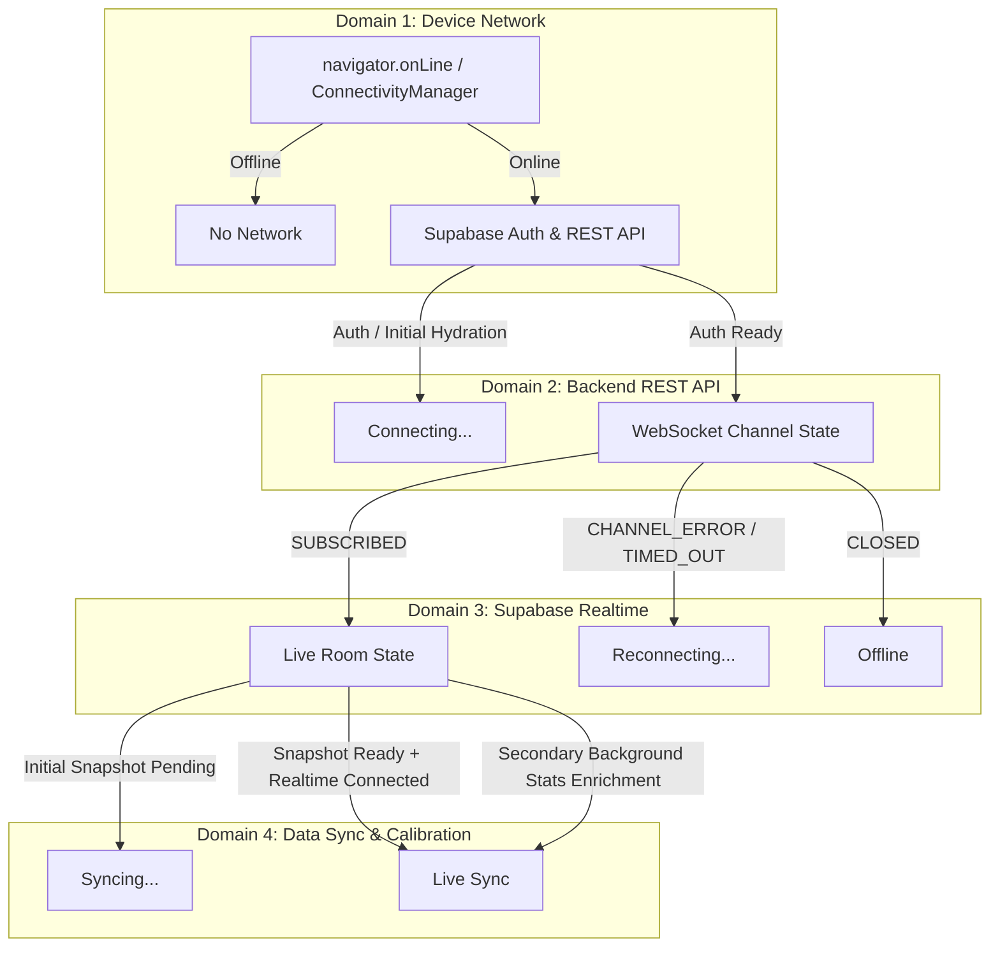

# STUDYROOM REALTIME RECOVERY & ARCHITECTURE PLAN
**Document Reference:** PLAN-20261019-RT-RECOVERY  
**Classification:** Architectural Recovery & System Hardening  
**Date:** October 19, 2026  
**Auditor / Lead Architect:** Principal Real-time Systems Engineer & Architecture Lead  
**Scope:** Android WebView/PWA Shell, Service Worker, Supabase Realtime Engine, Room Sync Protocol, Active Session Timers  

---

## 1. System Recovery Objectives

This recovery plan provides the architectural specifications and execution roadmap to eliminate:
1. False offline lockouts on Android cold starts.
2. Inaccurate or trapped "Syncing…" states in the Global Room.
3. Frozen `00:00:00` study timers on web page hydration and refreshes.

The core principle of this plan is **truthful real-time observability**: every status indicator, timer, and network fallback must accurately reflect genuine system state without confusing background analytics enrichment with core real-time liveliness.

---

## 2. The 4-Domain State Model

To eliminate ambiguous or conflicting states, StudyRoom separates observability into 4 independent domains:



### Domain 1: Device Network
- **Signals**: `navigator.onLine` in web/PWA; `ConnectivityManager.NetworkCallback` in Android native.
- **Rules**:
  - When network is absent, the UI shows "No network".
  - Offline fallback page (`offline.html`) must continuously monitor `window.addEventListener('online')` and perform background reachability checks to automatically re-enter the app as soon as connectivity resumes.

### Domain 2: Backend REST API & Authentication
- **Signals**: `useAuth().loading`, `useAuth().user`, `useAuth().profile`.
- **Rules**:
  - During cold startup, the app is in `isHydrating` state.
  - Active session hooks must not default to `0` or drop active state while waiting for auth resolution; instead, they utilize local cached profile or provisional storage until authoritative profile arrives.

### Domain 3: Supabase Realtime Transport
- **Signals**: Realtime channel lifecycle state (`SUBSCRIBED`, `TIMED_OUT`, `CHANNEL_ERROR`, `CLOSED`).
- **Rules**:
  - `SUBSCRIBED` = Realtime streaming is fully operational.
  - `TIMED_OUT` or `CHANNEL_ERROR` = Transient transport disruption; transition status to `reconnecting` with exponential backoff and REST fallback.
  - `CLOSED` = Channel closed explicitly; transition status to `offline`.

### Domain 4: Data Synchronization & Calibration
- **Signals**: `initialSnapshotReady`, `members.length`, `isSecondaryFetching`, `isTimerCalibrating`.
- **Rules**:
  - **Primary Room Snapshot**: Single-table query on `users` (<30ms). Once loaded and channel is `SUBSCRIBED`, room is immediately **Live Sync**.
  - **Secondary Enrichment**: Background stats (24h history, weekly streaks, leaderboard score, rivalry events). **Secondary enrichment must NEVER downgrade a live room to "Syncing…"**.

---

## 3. Honest Status Pill State Machine

The Global Room status pill in `components/room/MemberList.tsx` is revised to follow a deterministic, mutually exclusive priority ladder:

```
[Level 1: No Network]
  └── navigator.onLine === false
      => "No network" (bg-zinc-500)

[Level 2: Transport Offline]
  └── connectionState === "offline" || (!connectionState && !isRealtimeConnected && !isOnline)
      => "Offline" (bg-zinc-500)

[Level 3: Transport Reconnecting]
  └── connectionState === "reconnecting"
      => "Reconnecting..." (bg-amber-400 animate-pulse)

[Level 4: Initial Room Snapshot / Initial Connecting]
  └── isLoading && members.length === 0
      => "Connecting..." (bg-sky-400 animate-pulse)

[Level 5: Forced Full Resync (Explicit)]
  └── isHardResyncing && members.length === 0
      => "Syncing..." (bg-blue-400 animate-pulse)

[Level 6: Authoritative Live State]
  └── isRealtimeConnected && (members.length > 0 || !isLoading)
      => "Live Sync" (bg-fuchsia-400 animate-pulse)
```

### Invariant Guarantees:
- **No Background Theft of Live State**: Background secondary reconciliation (`isReconciling = true`) runs silently in Phase 2 and updates secondary stats without modifying the status pill.
- **Accurate Feedback**: The user is only told "Syncing…" when a fundamental room data snapshot is actively blocking display.

---

## 4. Active Session Timer Restoration Anchor Model

To eliminate the `00:00:00` freeze on the website, `hooks/useActiveSession.ts` and `lib/time/format.ts` are hardened with the following multi-tier anchor protocol:

### 1. Immediate Profile Hydration Effect for `currentStatus === "studying"`
Mirroring the existing break synchronization effect, add an explicit effect that executes as soon as `profile` hydrates with an active study session:

```typescript
useEffect(() => {
  if (currentStatus === "studying" && profile) {
    const calculated = calculateMemberElapsedStudySeconds(profile, getServerNow());
    if (calculated > 0) {
      lastAuthoritativeElapsedRef.current = calculated;
      setElapsedStudySeconds(calculated);
    }
  }
}, [
  currentStatus,
  profile?.session_start_time,
  profile?.last_resumed_at,
  profile?.active_study_seconds_snapshot,
  profile?.id,
]);
```

### 2. Elimination of Calibrating Fallthrough to `0`
In `computeCurrentSeconds()`, if `isMemberTimerCalibrating(p)` returns `true` (e.g., when a profile has accrued snapshot duration or is waiting for a resume update), the engine must **never return 0** if `p.session_start_time` or `p.active_study_seconds_snapshot` exists:

```typescript
// Tier 1: Authoritative profile timestamps (if not calibrating)
if (p && p.current_status === "studying" && !isMemberTimerCalibrating(p)) {
  const s = calculateMemberElapsedStudySeconds(p, now);
  lastAuthoritativeElapsedRef.current = s;
  return s;
}
// Tier 2: Authoritative server session_blocks
const b = blocksRef.current;
if (b && b.length > 0) {
  const s = calculateActiveStudySeconds(b, now);
  lastAuthoritativeElapsedRef.current = s;
  return s;
}
// Tier 3: Local cached study state
const studyState = getActiveStudyState();
if (studyState && studyState.sessionStartTime) {
  ...
  lastAuthoritativeElapsedRef.current = s;
  return s;
}
// Tier 4: Memory continuity while calibrating
if (lastAuthoritativeElapsedRef.current > 0) {
  return lastAuthoritativeElapsedRef.current;
}
// Tier 5: Safe Profile Fallback Anchor (Prevents 00:00:00 freeze!)
if (p && p.current_status === "studying") {
  const fallbackSeconds = calculateMemberElapsedStudySeconds(p, now);
  if (fallbackSeconds > 0) {
    lastAuthoritativeElapsedRef.current = fallbackSeconds;
    return fallbackSeconds;
  }
}
return 0;
```

### 3. Non-Zero Fallback on Empty Blocks
In `fetchSessionBlocks()`, if `session_blocks` query returns 0 rows, check if `profile.current_status === "studying"`. If so, compute `calculateMemberElapsedStudySeconds(profile, serverNow)` and set `elapsedStudySeconds` rather than leaving the timer uninitialized.

---

## 5. Mobile Offline Shell & Service Worker Hygiene

### 1. Generous Navigation Timeout in `public/sw.js`
- Increase the navigation fetch timeout from `3000ms` to `10000ms` (10 seconds).
- 10 seconds provides ample margin for cold DNS lookups, TLS edge handshakes, and SSR payload streaming on mobile cellular connections without triggering false offline pages.

### 2. Auto-Reconnecting Offline Page (`public/offline.html`)
- Add an inline auto-reconnection script to `offline.html` that:
  - Listens to `window.addEventListener('online', () => window.location.reload())`.
  - Listens to `document.addEventListener('visibilitychange')` to reload if device returns from background while online.
  - Implements an exponential backoff ping (2s, 4s, 8s, 16s) against `/favicon.ico?t=...` with `cache: 'no-store'`. As soon as the ping succeeds, it automatically executes `window.location.replace('/room')`.

### 3. Native Android Shell Hardening (`MainActivity.java`)
- In `MainActivity.java`'s `networkCallback.onAvailable()`, check not only `offlineContainer.getVisibility() == View.VISIBLE`, but also whether the `webView` is currently displaying `offline.html` or an offline URL:
  ```java
  String url = (webView != null) ? webView.getUrl() : null;
  boolean isShowingOfflinePage = (url != null && (url.contains("offline") || url.endsWith("/offline.html")));
  if (offlineContainer.getVisibility() == View.VISIBLE || isShowingOfflinePage) {
      offlineContainer.setVisibility(View.GONE);
      if (webView != null) {
          webView.setVisibility(View.VISIBLE);
          webView.loadUrl(baseUrl + "/room");
      }
  }
  ```

---

## 6. Implementation & Verification Sequence

1. **Phase 1**: Author Incident Report & Recovery Plan artifacts.
2. **Phase 2**: Implement Service Worker & Offline HTML auto-reconnect fixes (Incident A).
3. **Phase 3**: Harden Android `MainActivity.java` connectivity handler (Incident A).
4. **Phase 4**: Fix `useLiveRoom.ts` variable shadowing, generation lock, and status decoupling (Incident B).
5. **Phase 5**: Update `MemberList.tsx` status pill state machine (Incident B).
6. **Phase 6**: Implement Active Session timer restoration anchor and hydration sync (Incident C).
7. **Phase 7**: Add comprehensive regression tests in `tests/unit/` covering:
   - Web timer restoration without 00:00:00 freeze.
   - Status pill transition and secondary enrichment isolation.
   - Service worker offline navigation fallback behavior.
8. **Phase 8**: Execute verification suite (`vitest`, `tsc`, `lint`, `build`) and author `STUDYROOM_REALTIME_FIX_VERIFICATION.md`.
